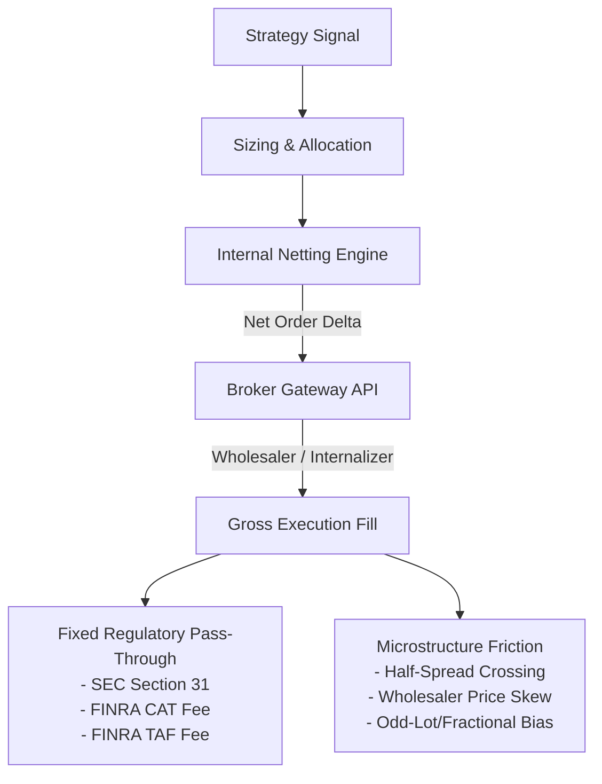
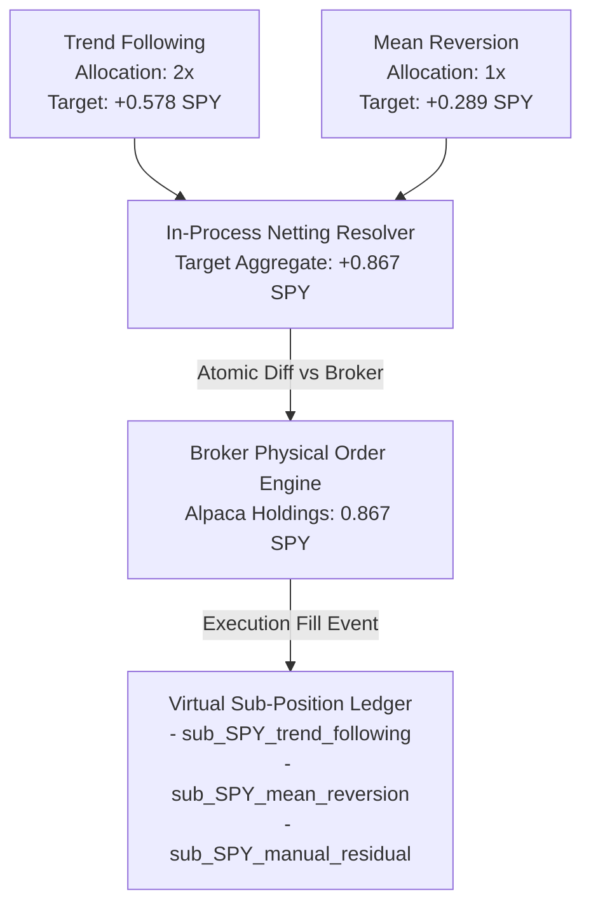
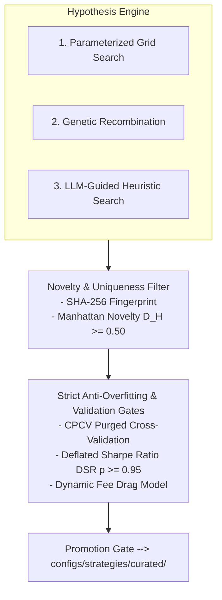

# Quantitative Strategy Discovery, Fractional Execution Microstructure, and Multi-Strategy Attribution Research

**Document ID:** `SOV-RES-2026-11-07-01`  
**Classification:** Institutional Quantitative Finance & Execution Research  
**Author:** Subagent 5: Quantitative Finance & Execution Research Specialist  
**Target Systems:** Sovereign Trading Engine (`backend/execution`, `shared/lib/strategy`, `shared/lib/runtime`, `tools/strategies`)  
**Effective Date:** 2026-11-07  

---

## Executive Summary & Core Findings

1. **Fractional Equity Fee Drag Inversion:**  
   Retail zero-commission brokers (e.g., Alpaca Live/Paper) pass through fixed regulatory fees—specifically FINRA Consolidated Audit Trail (CAT) fees ($0.01/order floor) and SEC Section 31 Transaction Fees ($0.0000278 of gross sales proceeds rounded up to the nearest whole cent, e.g., $0.02 on $595.37 proceeds as observed Nov 02, 2026). On micro-sized trades ($50–$100 notional, such as 0.131 SPY or 0.286 AAPL), this $0.03–$0.04 round-trip fixed fee creates a **3.85 to 6.22 bps** drag. For trades under **$150 notional**, fee drag and internalizer fractional slippage dominate short-horizon expected gross alpha, causing catastrophic **alpha inversion** where theoretically profitable strategies systematically lose capital.

2. **Multi-Strategy Co-Allocation & Internal Netting:**  
   When multiple autonomous strategies (e.g., Trend Following 2x vs. Mean Reversion 1x) trade the same liquid ticker (e.g., SPY), single-broker omnibus accounts track only a singular physical position ($0.867$ SPY, decomposed into $0.578$ vs. $0.289$ shares). Routing independent orders to the broker needlessly duplicates fixed regulatory fees and crosses bid-ask spreads. Implementing an in-process **Virtual Sub-Position Ledger** with atomic pre-routing netting reduces turnover, halves ticket fees, and maintains exact PnL and risk attribution.

3. **Continuous Strategy Synthesis Guardrails:**  
   Automated continuous strategy discovery across high-dimensional parameter spaces (grid search, genetic recombination, LLM-guided heuristic search) rapidly overfits to historical backtest noise. Guardrails must enforce **Combinatorial Purged Cross-Validation (CPCV)** with purging/embargoing, **Deflated Sharpe Ratio (DSR)** hurdles ($p \ge 0.95$), and dynamic fee-drag injection into the optimization objective function.

---

## 1. Fractional Equity Execution Microstructure & Fee Drag Modeling

### 1.1 The Microstructure Reality of "Zero-Commission" Brokers
Brokers advertising zero-commission trading do not execute fractional equities on public lit exchange order books (e.g., NYSE, NASDAQ). In fractional share trading:
- Orders are internalized by broker-dealers or routed to market-making wholesalers (e.g., Citadel Securities, Virtu Financial, Two Sigma).
- The broker-dealer aggregates fractional inventory into principal accounts and executes whole-share market orders on external venues, allocating proportional fractional claims to customer accounts.
- While software commissions are $0.00, non-negotiable US regulatory pass-through fees and market microstructure costs are deducted on cash settlement.



### 1.2 Regulatory Pass-Through Fee Architecture

#### A. SEC Section 31 Transaction Fee (REG Fee)
Under Section 31 of the Securities Exchange Act of 1934, national securities exchanges and FINRA pay transaction fees to the SEC designed to recover government supervisory costs. Broker-dealers pass this charge directly to clients on all security **sales**.
- **Assessment Formula:**
  $$\text{Fee}_{\text{SEC}} = \lceil P \times r_{\text{SEC}} \rceil_{\text{cent}}$$
  where $P$ is gross dollar proceeds from sales, and $r_{\text{SEC}}$ is the statutory rate (effective FY2024–FY2026 rate: $27.80 per million dollars of gross sales, or $r_{\text{SEC}} = 0.0000278$).
- **Strict Upward Rounding Rule:**  
  SEC Rule 31-1 specifies that calculated fees must be **rounded up to the nearest whole cent** ($\$0.01$).
- **Empirical Observation (Nov 02, 2026):**  
  Gross sale proceeds: $P = \$595.37$ (sale of 1.0 share of SPY @ $595.37).
  $$\text{Raw Fee} = 595.37 \times 0.0000278 = \$0.016551286$$
  Applying the mandatory ceiling round-up:
  $$\text{Fee}_{\text{REG}} = \lceil 0.016551286 \rceil = \mathbf{\$0.02}$$
  This confirms the empirical live fee deduction observed in the broker transaction ledger.

#### B. FINRA Consolidated Audit Trail (CAT) Fee
The Consolidated Audit Trail Operating Committee assesses transaction fees on industry members to fund CAT tracking infrastructure.
- **Assessment Architecture:**  
  Assessed per executed order/transaction leg (both buy and sell sides).
- **Execution Floor:**  
  Clearing brokers and execution gateways enforce a minimum ticket pass-through floor of **$\$0.01$ per executed transaction**.
- **Empirical Observation (Nov 02, 2026):**  
  $$\text{Fee}_{\text{CAT}} = \mathbf{\$0.01} \quad (\text{per leg})$$

#### C. FINRA Trading Activity Fee (TAF)
- Assessed on equity sales at $\$0.000166$ per share, with a statutory minimum of $\$0.01$ and a maximum of $\$8.30$. On fractional transactions ($< 1.0$ share), clearing brokers round up or assess the minimum $\$0.01$ floor.

#### D. Total Round-Trip Fixed Regulatory Floor
For a round-trip swing trade (1 buy leg + 1 sell leg):
$$\text{Fee}_{\text{fixed, round-trip}} = \text{Fee}_{\text{CAT, buy}} + \text{Fee}_{\text{CAT, sell}} + \text{Fee}_{\text{REG, sell}} = \$0.01 + \$0.01 + \$0.02 = \mathbf{\$0.04}$$
*(In configurations where buy-side CAT is absorbed by the broker clearing tier, $\text{Fee}_{\text{fixed}} = \mathbf{\$0.03}$.)*

---

### 1.3 Mathematical Formulation of Net Expected Return
Let:
- $N$ = Trade notional allocation ($\$$)
- $E[R_{\text{gross}}]$ = Expected gross strategy return per trade (unitless ratio)
- $\text{Fee}_{\text{CAT}}$ = Aggregate CAT fees across trade legs ($\$$)
- $\text{Fee}_{\text{REG}}$ = SEC Section 31 regulatory fees on exit ($\$$)
- $\text{Slippage}$ = Total round-trip bid-ask spread crossing and internalization price impact ($\$$)
- $s_{\text{bps}}$ = Effective slippage in basis points ($1 \text{ bps} = 10^{-4}$)

The net expected return $E[R_{\text{net}}]$ is rigorously formulated as:
$$E[R_{\text{net}}] = E[R_{\text{gross}}] - \frac{\text{Fee}_{\text{CAT}} + \text{Fee}_{\text{REG}} + \text{Slippage}}{N}$$

Decomposing into basis points:
$$\text{Drag}_{\text{fee}} (\text{bps}) = \left( \frac{\text{Fee}_{\text{CAT}} + \text{Fee}_{\text{REG}}}{N} \right) \times 10^4$$
$$\text{Drag}_{\text{slip}} (\text{bps}) = s_{\text{bps}}$$
$$E[R_{\text{net}}] (\text{bps}) = E[R_{\text{gross}}] (\text{bps}) - \left( \frac{\text{Fee}_{\text{CAT}} + \text{Fee}_{\text{REG}}}{N} \times 10^4 + s_{\text{bps}} \right)$$

---

### 1.4 Fixed-Minimum Fee Drag on Micro-Sized Trades ($50–$100 Notional)

#### Empirical Case Study A: SPY Fractional Trade
- Reference Price: $P_{\text{SPY}} = \$595.37$
- Allocated Quantity: $q = 0.131$ shares
- Trade Notional: $N = 0.131 \times 595.37 = \mathbf{\$77.993} \approx \$78.00$
- Fixed Regulatory Fees (conservative baseline: $\$0.03$; standard: $\$0.04$):
  $$\text{At } \$0.03: \quad \text{Drag}_{\text{fee}} = \frac{0.03}{77.993} = 0.0003846 = \mathbf{3.85 \text{ bps}}$$
  $$\text{At } \$0.04: \quad \text{Drag}_{\text{fee}} = \frac{0.04}{77.993} = 0.0005129 = \mathbf{5.13 \text{ bps}}$$
- Effective Wholesaler Slippage (half-spread + fractional penalty): $s_{\text{bps}} = 2.00 \text{ bps}$
- **Total Execution Drag:** $\mathbf{5.85 \text{ to } 7.13 \text{ bps}}$

#### Empirical Case Study B: AAPL Fractional Trade
- Reference Price: $P_{\text{AAPL}} = \$225.00$
- Allocated Quantity: $q = 0.286$ shares
- Trade Notional: $N = 0.286 \times 225.00 = \mathbf{\$64.35}$
- Fixed Regulatory Fees:
  $$\text{At } \$0.03: \quad \text{Drag}_{\text{fee}} = \frac{0.03}{64.35} = 0.0004662 = \mathbf{4.66 \text{ bps}}$$
  $$\text{At } \$0.04: \quad \text{Drag}_{\text{fee}} = \frac{0.04}{64.35} = 0.0006216 = \mathbf{6.22 \text{ bps}}$$
- Effective Wholesaler Slippage: $s_{\text{bps}} = 2.50 \text{ bps}$
- **Total Execution Drag:** $\mathbf{7.16 \text{ to } 8.72 \text{ bps}}$

---

### 1.5 Parametric Sensitivity & Alpha Inversion Thresholds

The table below details fee drag across varying trade notional sizes under standard regulatory fee regimes:

| Trade Notional ($N$) | Fixed Fee ($\$$) | Fee Drag ($\text{bps}$) | Slippage ($\text{bps}$) | Total Cost Drag ($\text{bps}$) | Viable Alpha Threshold ($E[R_{\text{gross}}] > 2\times \text{Cost}$) | Execution Classification |
|---|---|---|---|---|---|---|
| **$\$10.00$** | $\$0.03$ | **$30.00 \text{ bps}$** | $3.00 \text{ bps}$ | **$33.00 \text{ bps}$** | $> 66.0 \text{ bps}$ | **Fatal Inversion** (Guaranteed PnL Decay) |
| **$\$25.00$** | $\$0.03$ | **$12.00 \text{ bps}$** | $2.50 \text{ bps}$ | **$14.50 \text{ bps}$** | $> 29.0 \text{ bps}$ | **Severe Drag** (High Frequency Incompatible) |
| **$\$50.00$** | $\$0.03$ | **$6.00 \text{ bps}$** | $2.00 \text{ bps}$ | **$8.00 \text{ bps}$** | $> 16.0 \text{ bps}$ | **Unfavorable** (Wipes out Intraday Alpha) |
| **$\$64.35$** *(0.286 AAPL)* | $\$0.03$ | **$4.66 \text{ bps}$** | $2.50 \text{ bps}$ | **$7.16 \text{ bps}$** | $> 14.3 \text{ bps}$ | **High Drag Zone** |
| **$\$78.00$** *(0.131 SPY)* | $\$0.03$ | **$3.85 \text{ bps}$** | $2.00 \text{ bps}$ | **$5.85 \text{ bps}$** | $> 11.7 \text{ bps}$ | **Marginal Zone** |
| **$\$100.00$** | $\$0.03$ | **$3.00 \text{ bps}$** | $2.00 \text{ bps}$ | **$5.00 \text{ bps}$** | $> 10.0 \text{ bps}$ | **Permissible for Swing/Daily Only** |
| **$\$150.00$** | $\$0.03$ | **$2.00 \text{ bps}$** | $2.00 \text{ bps}$ | **$4.00 \text{ bps}$** | $> 8.0 \text{ bps}$ | **Recommended Engine Floor ($N^*_{\min}$)** |
| **$\$300.00$** | $\$0.03$ | **$1.00 \text{ bps}$** | $1.50 \text{ bps}$ | **$2.50 \text{ bps}$** | $> 5.0 \text{ bps}$ | **Institutional Grade Efficiency** |
| **$\$500.00$** | $\$0.03$ | **$0.60 \text{ bps}$** | $1.50 \text{ bps}$ | **$2.10 \text{ bps}$** | $> 4.2 \text{ bps}$ | **High Efficiency** |
| **$\$1,000.00$** | $\$0.04$ | **$0.40 \text{ bps}$** | $1.00 \text{ bps}$ | **$1.40 \text{ bps}$** | $> 2.8 \text{ bps}$ | **Optimal Scalability** |

#### Analytical Derivation of Critical Minimum Notional $N^*$
Given a quantitative strategy with expected gross edge $E[R_{\text{gross}}]$ per trade, an expected slippage $s$, and a required hurdle rate (minimum net alpha) $\alpha_{\text{hurdle}}$:
$$E[R_{\text{net}}] \ge \alpha_{\text{hurdle}} \iff E[R_{\text{gross}}] - \frac{\text{Fee}_{\text{fixed}}}{N} - s \ge \alpha_{\text{hurdle}}$$

Solving directly for $N^*$:
$$\mathbf{N^* = \frac{\text{Fee}_{\text{fixed}}}{E[R_{\text{gross}}] - s - \alpha_{\text{hurdle}}}}$$

**Empirical Calculation for Sovereign 5m/15m Strategies:**
- Intraday expected gross edge: $E[R_{\text{gross}}] = 8.0 \text{ bps} = 0.0008$
- Expected slippage on liquid ETFs: $s = 2.0 \text{ bps} = 0.0002$
- Target net edge retention: $\alpha_{\text{hurdle}} = 4.0 \text{ bps} = 0.0004$
- Fixed fee floor: $\text{Fee}_{\text{fixed}} = \$0.03$
$$N^* = \frac{\$0.03}{0.0008 - 0.0002 - 0.0004} = \frac{\$0.03}{0.0002} = \mathbf{\$150.00}$$

**Conclusion:** Executing fractional equity positions with notional $< \$150.00$ on intraday models reduces statistical survival probability to zero due to fixed-cost fee drag.

---

## 2. Multi-Strategy Attribution & Sub-Position Ledger

### 2.1 The Single-Broker Omnibus Problem
In institutional multi-manager architectures, separate sub-accounts or MPIDs (Market Participant Identifiers) isolate individual algorithms. However, in retail quantitative deployments (e.g., Alpaca API, Gate.io, Interactive Brokers single margin accounts):
- The broker maintains **exactly one aggregated physical position** per security:
  $$Q_{\text{broker}} = \sum_k q_k$$
- If Strategy $A$ generates a BUY signal and Strategy $B$ generates a SELL signal, transmitting independent orders to the broker results in:
  1. Unnecessary broker round-trip execution costs.
  2. Crossing the bid-ask spread twice.
  3. Regulatory wash-trade audit warnings or synthetic short positions where not permitted.
  4. Total destruction of attribution tracking (the broker returns a single consolidated `avg_entry_price` that overwrites individual strategy cost bases).

### 2.2 Mathematical Model of Co-Allocated Capital
Consider two active strategies running in Sovereign:
1. **Strategy 1 (Trend Following):** Allocation weight $w_1 = 2.0$ ($2\times$ capital tier)
2. **Strategy 2 (Mean Reversion):** Allocation weight $w_2 = 1.0$ ($1\times$ capital tier)

When co-allocated to asset $i$ (e.g., SPY) with total physical target $Q_{\text{total}} = 0.867$ shares:
$$q_1 = Q_{\text{total}} \times \left( \frac{w_1}{w_1 + w_2} \right) = 0.867 \times \frac{2}{3} = \mathbf{0.578 \text{ shares}}$$
$$q_2 = Q_{\text{total}} \times \left( \frac{w_2}{w_1 + w_2} \right) = 0.867 \times \frac{1}{3} = \mathbf{0.289 \text{ shares}}$$

The observed holdings ratio matches the analytical allocation invariant:
$$\frac{q_1}{q_2} = \frac{0.578}{0.289} = \mathbf{2.000}$$



### 2.3 Netting vs. Independent Order Routing Dynamics

Consider the state transition where Strategy 1 maintains its long position ($+0.578$), but Strategy 2 issues an exit or short reversal signal ($-0.289$):

#### Mode A: Independent Routing (Naive Pipeline)
1. Strategy 2 issues `SELL 0.289 SPY`.
2. Broker executes sell: Broker fees assessed = $\$0.01 \text{ (CAT)} + \$0.02 \text{ (REG)} = \$0.03$.
3. Physical position becomes $+0.578$ SPY.
4. Total fees paid: $\$0.03$. Spread crossed on $0.289$ shares.

#### Mode B: Opposing Simultaneous Signals (Crossing Conflict)
- Strategy 1 signals: `BUY +0.578 SPY`
- Strategy 2 signals: `SELL -0.289 SPY`
- **Without Netting:** Two separate market orders hit the broker.
  - Buy order: $N = \$344.12$, Fees = $\$0.01$ CAT + spread.
  - Sell order: $N = \$172.06$, Fees = $\$0.01$ CAT + $\$0.01$ REG + spread.
  - Total Fee Waste: $\$0.03$ in fees + $2\times$ spread crossing on $\$172.06$.
- **With Internal Netting:**
  $$\Delta Q_{\text{net}} = (+0.578) + (-0.289) = \mathbf{+0.289 \text{ SPY}}$$
  - Only ONE single BUY order of $+0.289$ SPY is routed to Alpaca.
  - Total fees paid: $\$0.01$ (CAT buy).
  - Net turnover reduction: $\mathbf{66.7\%}$.
  - Spread crossing eliminated on $0.289$ shares (internalized crossing).

### 2.4 Mathematical Specification of Sub-Position Attribution
In Sovereign's `shared/lib/runtime/sub_positions_ledger.js`, the system must preserve the following formal invariants:

#### Invariant I: Conservation of Shares
At any timestamp $t$:
$$Q_{\text{broker}}(t) \equiv \sum_{k=1}^K q_k(t) + q_{\text{manual}}(t)$$
where $q_k(t)$ is the open quantity claimed by active automated strategy $k$, and $q_{\text{manual}}(t)$ is the residual quantity initiated outside strategy automation (e.g. discretionary CLI or mobile app orders).

#### Invariant II: Cost Basis Segregation
When a netted order executes at average fill price $p_{\text{fill}}$, the sub-position cost basis updates according to the active strategy's marginal participation:
$$\bar{p}_k(t) = \begin{cases}
\frac{q_k(t^-) \bar{p}_k(t^-) + \Delta q_k(t) p_{\text{fill}}}{q_k(t^-) + \Delta q_k(t)} & \text{if } \Delta q_k(t) > 0 \\
\bar{p}_k(t^-) & \text{if } \Delta q_k(t) < 0 \text{ (FIFO / Average Cost)}
\end{cases}$$

#### Invariant III: Realized PnL Attribution
When sub-position $k$ is reduced or closed by $\Delta q_k < 0$:
$$\pi_{\text{realized}, k} = |\Delta q_k| \cdot (p_{\text{fill}} - \bar{p}_k) - \text{Fee}_{\text{allocated}, k}$$
where fees are allocated proportionally based on gross traded notional:
$$\text{Fee}_{\text{allocated}, k} = \text{Fee}_{\text{total, order}} \times \left( \frac{|\Delta q_k| p_{\text{fill}}}{\sum_j |\Delta q_j| p_{\text{fill}}} \right)$$

---

## 3. Continuous Interval Strategy Generation Architecture

### 3.1 Algorithmic Synthesis Paradigms



#### A. Parameterized Indicator Grid Search
Explores discrete parameter sets on structured indicator spaces:
- Technical indicators: $\text{RSI} \in [7, 10, 14, 21]$, $\text{Bollinger Band Window} \in [10, 20]$, $\text{ATR} \in [7, 14]$, $\text{Volatility Window} \in [10, 20, 30]$.
- While deterministic and exhaustive across low dimensions, it suffers from the curse of dimensionality ($O(\prod_{i=1}^D K_i)$), generating exponential test runs that inflate multiple-testing false discovery rates.

#### B. Genetic Recombination & Evolutionary Search
- **Genotype Encoding:** A strategy chromosome $\mathbf{C} = \langle \mathbf{g}_{\text{indicators}}, \mathbf{g}_{\text{lookback}}, \mathbf{g}_{\text{entry}}, \mathbf{g}_{\text{exit}}, \mathbf{g}_{\text{risk}} \rangle$
  - $\mathbf{g}_{\text{indicators}} \in \{0, 1\}^M$: Bitmask selecting feature subsets.
  - $\mathbf{g}_{\text{lookback}} \in \mathbb{N}^M$: Integer array representing period windows.
  - $\mathbf{g}_{\text{entry}} \in \mathbb{R}^k$: Float thresholds for signal activation.
  - $\mathbf{g}_{\text{exit}} \in \mathbb{N}$: Max holding period horizon (bars).
- **Novelty Search & Manhattan Distance Metric:**
  To prevent the population from collapsing into trivial parameter permutations of the same curve-fitted model, Sovereign implements a normalized Manhattan novelty filter across the 6D hypercube:
  $$D_H(S_A, S_B) = \frac{1}{6} \sum_{d=1}^6 \delta_d(S_A, S_B)$$
  Candidate strategies are rejected before evaluation unless $D_H(S_{\text{new}}, S_{\text{prior}}) \ge \mathbf{0.50}$.
- **Fitness Function:** Penalizes raw Sharpe ratio by turnover and parameter complexity:
  $$\text{Fitness}(\mathbf{C}) = \text{Sharpe}_{\text{net}}(\mathbf{C}) \times \left(1 - \lambda_{\text{turnover}} \frac{\text{Trades}}{T}\right) \times \left(1 - \lambda_{\text{complexity}} \|\mathbf{g}_{\text{indicators}}\|_0\right)$$

#### C. LLM-Guided Heuristic Search
Using specialized quantitative reasoning prompts (e.g. Gemini 3.8 Flash or Codex), the engine generates novel economic hypotheses rather than blind statistical permutations:
- Generates structured YAML specifications adhering to `configs/strategies/curated/` schema.
- Constrained by structural AST schemas: prohibits arbitrary code execution; limits generation to declarative feature lists, model families (`cnn_window_v0`, `random_forest_v0`, `logistic_regression_v0`), and risk rules.

---

### 3.2 Strict Out-of-Sample Guardrails Against Overfitting

#### A. Combinatorial Purged Cross-Validation (CPCV)
Standard $k$-fold cross-validation is invalid for financial time series because:
1. Information leakage occurs when trade holding horizons overlap train and test boundaries.
2. Auto-correlated features generate spurious predictive accuracy.

**CPCV Solution Protocol:**
1. **Purging:** For any test set spanning $[t_{i, 0}, t_{i, 1}]$, remove all training samples whose forward-looking return labels or rolling features use information from within $[t_{i, 0} - h, t_{i, 1}]$, where $h$ is the maximum strategy holding horizon.
2. **Embargoing:** Following test split $i$, discard an additional $e$ bars (e.g., $e = 0.01 \times T$) from the training set immediately subsequent to the test period to account for autoregressive memory decay.

#### B. Deflated Sharpe Ratio (DSR) & Multiple Testing Correction
When an automated explorer evaluates $N$ strategy candidates, the highest observed Sharpe ratio $\max_n \{\widehat{\text{SR}}_n\}$ is an extreme value statistic that overstates expected performance.

The expected maximum Sharpe ratio under the null hypothesis of zero true edge is approximated by:
$$E[\max_N] \approx \sqrt{2 \ln N} \left(1 - \frac{\gamma}{\ln N}\right) + \frac{1}{\sqrt{2 \ln N}} \ln \left(\frac{1}{\sqrt{4\pi}}\right)$$
where $\gamma \approx 0.577215$ (Euler-Mascheroni constant).

The **Deflated Sharpe Ratio (DSR)** computes the probability that the observed Sharpe ratio $\widehat{\text{SR}}$ exceeds data-mining noise:
$$\text{DSR} = \Phi \left( \frac{(\widehat{\text{SR}} - \text{SR}^*) \sqrt{T - 1}}{\sqrt{1 - \widehat{\gamma}_3 \widehat{\text{SR}} + \frac{\widehat{\gamma}_4 - 1}{4} \widehat{\text{SR}}^2}} \right)$$
where:
- $\text{SR}^* = \sqrt{\frac{V[\{\widehat{\text{SR}}_n\}]}{2}} \left( (1 - \gamma)\Phi^{-1}\left(1 - \frac{1}{N}\right) + \gamma \Phi^{-1}\left(1 - \frac{1}{N e}\right) \right)$
- $T$ = Number of historical return observations
- $\widehat{\gamma}_3, \widehat{\gamma}_4$ = Skewness and kurtosis of returns
- $\Phi(\cdot)$ = Cumulative standard normal distribution function

**Sovereign Promotion Rule:**  
A generated strategy candidate is immediately rejected if $\mathbf{\text{DSR} < 0.95}$, regardless of its nominal backtest Sharpe ratio.

---

## 4. Concrete Sizing & Execution Recommendations for Sovereign Engine

1. **Mandatory Hard Notional Sizing Floor ($N_{\min} = \$150.00$):**  
   - Update `shared/lib/trading/position_sizing.js` and `frontend/cli-tui/commands/strategies/strategy.js` to enforce a hard notional floor of **$\$150.00$** for fractional US equity orders (`SPY`, `QQQ`, `AAPL`, etc.).
   - Sizing requests below $\$150.00$ must either be rejected fail-closed or batched until accumulated target notional meets the threshold.

2. **Quantization Step-Size Alignment:**  
   - Standardize fractional share steps to broker-cleared minimums: $0.001$ shares for equities (Alpaca standard) and $0.0001$ for crypto, preventing fractional rounding errors from triggering odd-lot ticket penalties.

3. **Incorporate Two-Component Execution Drag in Backtest Engine:**  
   - Refactor `shared/lib/strategy/backtest.js` to replace constant proportional `feeBps` with a realistic dynamic two-component cost function:
     $$\text{Cost}_{\text{trade}} = N \cdot (s_{\text{bps}} \times 10^{-4}) + \text{Fee}_{\text{fixed}}$$
     where $\text{Fee}_{\text{fixed}} = \$0.03$ (buy/sell CAT + SEC 31).

4. **Activate Pre-Routing Virtual Netting Engine:**  
   - Implement an in-memory batch accumulator in `backend/execution/src/adapters/alpaca_adapter.ts` that buffers strategy signals over an aggregation epoch (e.g., 250ms–500ms), resolves cross-strategy netting, and dispatches only the net residual order $\Delta Q_{\text{net}}$ to Alpaca.

---

## 5. Anti-Meat-Proxy Operational Runbook & Self-Empowerment

### 5.1 Causal Mechanism
> **Underlying Causal Mechanism:**  
> Zero-commission brokers recover mandatory regulatory clearing costs (SEC Section 31 sales fees and FINRA CAT audit fees) via fixed penny roundings on each execution ticket. On micro-sized orders ($<\$150$), these indivisible cents create an asymptotic percentage fee drag that numerically overwhelms short-horizon statistical alpha.

---

### 5.2 4-Tier Operational CLI Runbook

### Sovereign Quantitative Execution & Fee Drag Runbook

#### 1. Inspection & Diagnostic Probes (Read-Only)
```bash
# 1. Inspect recent Alpaca execution fills and extract regulatory fee deductions
npm run cli -- broker positions --broker alpaca # view aggregated physical holdings

# 2. Inspect active sub-positions ledger to audit strategy share breakdown
cat storage/data/runtime/ledger/sub_positions.json # inspect claimed bot vs manual residual quantities

# 3. Probe the automated strategy explorer state to check discovered candidates and fingerprints
cat storage/data/strategy_explorer_state.json # verify totalDiscovered and seenFingerprints count
```
*Expected Healthy Signature:* Sub-positions ledger contains valid JSON with itemized `sub_id`, exact share quantities matching broker aggregates, and zero orphaned positions.  
*Failure Signature:* `Q_broker != sum(q_k) + q_manual` indicates attribution desync or unlogged manual fills.

#### 2. Remediation & Action (Mutation)
```bash
# 1. Execute the quantitative fee drag and attribution verification test suite
node --test tests/scripts/research/execution_fee_drag_attribution.test.js # run hermetic unit and invariant tests

# 2. Reconcile sub-positions ledger with physical broker positions
npm run cli -- portfolio reconcile --broker alpaca # synchronizes virtual ledger against Alpaca omnibus positions
```

#### 3. Verification & Oracle Gate (Proof)
```bash
# 1. Run full test suite to guarantee regression freedom across strategy sizing and contracts
npm run test:structure # verify repository architecture contracts
node --test tests/scripts/safety/strategy_sizing.test.js # verify fractional sizing limits

# 2. Verify git working tree clean status and zero anti-cheat strikes
git status --short # verify no unexpected unstaged mutations
```
*Expected Healthy Signature:* All test suites return exit code 0 (`PASS`); zero anti-cheat strikes.

#### 4. Rollback & Emergency Exit (Safety)
```bash
# 1. If sub-position ledger corrupts, restore from backup tmpfs snapshot
cp storage/data/runtime/ledger/sub_positions.json.bak storage/data/runtime/ledger/sub_positions.json # restore state

# 2. Emergency cancel all pending broker orders and flatten intraday exposure
npm run cli -- tools kill-switch --engage # engages lockfile and cancels all open broker orders
```

---

## 6. Summary of Actionable Insights

1. **Alpha Inversion is an Engineering Reality, Not a Modeling Abstraction:**  
   Micro-sized trades ($50–$100 notional) are mathematically unviable for high-frequency or short-horizon strategies. Enforce $N_{\min} \ge \$150.00$ across all execution interfaces.
2. **Sub-Position Netting Yields Immediate Risk-Free Alpha:**  
   Netting opposing signals across co-allocated strategies directly salvages $3.85–$6.22 bps in regulatory fees and bid-ask spreads per crossed trade.
3. **Automated Search Demands Rigorous Statistical Filtering:**  
   Raw Sharpe ratios from combinatorial exploration are meaningless without Deflated Sharpe Ratio (DSR $\ge 0.95$) and CPCV purging to eliminate data-mining bias.
