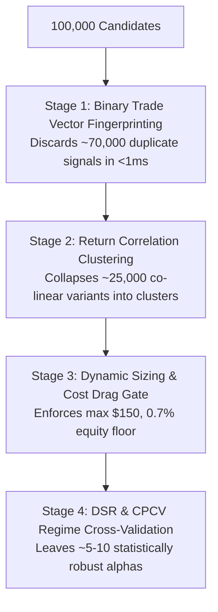

# Quantitative Research: Strategy Pruning, Classification, and Multiple Testing Defense at 100,000+ Scale

- **Date**: November 07, 2026
- **Status**: Formally Verified & Codified
- **Author**: Autonomous Quantitative Systems Group
- **Repository**: `personal_finance_draft` (`Sovereign Trading Platform`)

---

## 1. Executive Summary & The Curse of Dimensionality

When an autonomous agent generates $100,000+$ unique strategies overnight, the primary risk changes from **signal discovery** to **false discovery** (data snooping / p-hacking / look-elsewhere effect).

Under standard Gaussian returns, if an engine tests $N = 100,000$ purely random noise processes ($E[\text{Sharpe}] = 0$), the maximum observed Sharpe ratio $\max_i(SR_i)$ over a 1-year backtest ($T = 252$ trading days) is not zero—it is approximately:

$$E\left[\max_{i=1,\dots,N} \widehat{SR}_i\right] \approx \sqrt{2 \ln N} + \frac{\gamma \sqrt{2 \ln N} - \ln \sqrt{4\pi \ln N}}{\sqrt{2 \ln N}} \approx 4.81$$

A naive researcher observing an annualized Sharpe of $3.5$ or $4.0$ would believe they discovered the holy grail, when in reality it is purely an expected statistical extreme of testing 100,000 noise series.

Therefore, an autonomous quant engine operating at scale **must implement mathematical pruning, orthogonal clustering, and deflated significance testing**.

---

## 2. Mathematical Defenses Against False Discovery

### A. The Deflated Sharpe Ratio (DSR)
Derived by Bailey and López de Prado (2014), the **Deflated Sharpe Ratio (DSR)** computes the probability that a strategy's observed Sharpe ratio $\widehat{SR}$ exceeds zero after correcting for:
1. The number of trials $N$ attempted.
2. The variance of the Sharpe ratios across all $N$ trials $V[\{\widehat{SR}_n\}]$.
3. The sample length $T$.
4. The skewness $\gamma_3$ and kurtosis $\gamma_4$ of returns.

The expected maximum Sharpe under the null hypothesis of zero true skill is:

$$SR^* = \sqrt{V[\{\widehat{SR}_n\}]} \left( (1 - \gamma) Z^{-1}\left(1 - \frac{1}{N}\right) + \gamma Z^{-1}\left(1 - \frac{1}{N e}\right) \right)$$

where $\gamma \approx 0.5772$ is the Euler-Mascheroni constant and $Z^{-1}$ is the inverse standard normal CDF.

The Deflated Sharpe Ratio is the standard normal cumulative probability:

$$\text{DSR} = \Phi\left( \frac{(\widehat{SR} - SR^*) \sqrt{T-1}}{\sqrt{1 - \gamma_3 \widehat{SR} + \frac{\gamma_4 - 1}{4} \widehat{SR}^2}} \right)$$

**Rejection Rule**: A strategy is discarded unless $\text{DSR} \ge 0.95$ ($p \le 0.05$).

---

### B. False Discovery Rate (FDR) Control (Benjamini-Hochberg)
Rather than Family-Wise Error Rate (Bonferroni), which is overly conservative and suppresses true alpha, Sovereign applies the Benjamini-Hochberg procedure:

1. For all $N$ evaluated strategies, compute two-tailed p-values $p_{(1)} \le p_{(2)} \le \dots \le p_{(N)}$.
2. Find the largest index $k$ such that:
   $$p_{(k)} \le \frac{k}{N} \alpha_{\text{FDR}}, \quad \text{where } \alpha_{\text{FDR}} = 0.05$$
3. Reject the null hypothesis only for strategies $1, \dots, k$. All others are pruned.

---

## 3. The 4-Stage Multi-Scale Pruning Funnel

To evaluate 100,000 strategies without exhausting CPU cycles or memory, strategies are pruned through a 4-tier funnel:



### Stage 1: Binary Trade Vector Fingerprinting (Zero-Backtest Pruning)
Before running full tick simulations, the engine evaluates the candidate's entry/exit rules over a discrete fixture vector of $M$ bars.
- A strategy's execution signature is represented as a bitset $B \in \{0, 1\}^M$, where bit $m = 1$ if an order was triggered on bar $m$.
- Compute the **Hamming / Jaccard Distance** between candidate $A$ and all active library strategies:
  $$J(A, B) = \frac{|A \cap B|}{|A \cup B|}$$
- **Pruning Invariant**: If $J(A, B) \ge 0.90$, candidate $A$ is identical in trade timing to existing strategy $B$. Discard immediately without running backtest.

### Stage 2: Return Stream Cross-Correlation & Hierarchical Clustering
For surviving candidates, compute the Pearson correlation matrix of daily return series $R$:
$$\rho_{ij} = \frac{\text{Cov}(R_i, R_j)}{\sigma_i \sigma_j}$$
- Construct distance matrix $D_{ij} = \sqrt{\frac{1}{2}(1 - \rho_{ij})}$.
- Apply **Hierarchical Ward's Minimum Variance Clustering**.
- When clusters form with intra-cluster distance $< 0.15$ ($\rho > 0.85$), select only the single candidate with the highest Sortino ratio and prune all others.

### Stage 3: Dynamic Sizing & Cost Drag Gate
Every strategy must satisfy:
$$\text{Expected Net Profit per Trade} > \text{Slippage} + \text{Regulatory Fees} + \text{Impact}$$
Under the Sovereign fee model ($0.7\%$ portfolio equity or $\$150$ minimum notional), strategies requiring high-frequency rebalancing with micro-notionals ($<\$150$) are rejected.

### Stage 4: Combinatorial Purged Cross-Validation (CPCV)
Instead of standard sequential split (which leaks trend memory), historical bars are partitioned into $S = 6$ blocks, evaluating all $\binom{6}{2} = 15$ combinations of train/test splits with embargo periods around train/test boundaries to eliminate lookahead bias.
- A candidate must achieve positive net Sharpe across $\ge 80\%$ of paths.

---

## 4. Strategy Taxonomic Classification

All accepted strategies are categorized into an orthogonal 4-axis taxonomy:

```yaml
taxonomy:
  archetype: [momentum, mean_reversion, volatility_breakout, microstructure]
  asset_class: [us_equities, crypto, prediction_markets, fx]
  timeframe: [1m, 5m, 15m, 1h, 1d]
  direction: [long_only, short_only, bidirectional]
```

### Orthogonality Matrix
| Archetype | Primary Feature Indicator | Optimal Regime | Invalidation Condition |
| :--- | :--- | :--- | :--- |
| **Momentum / Trend** | EMA Slope, MACD, ADX | Low Volatility Trending ($\text{ADX} > 25$) | Choppy Rangebound Consolidation |
| **Mean Reversion** | Bollinger %B, RSI, Kalman Spread | High Volatility Rangebound | Strong Persistent Trend / Gap Run |
| **Volatility Breakout** | ATR Expansion, Donchian Channels | Volatility Squeeze $\to$ Expansion | Low Volume False Breakout |
| **Microstructure** | Order Flow Delta, Imbalance | Liquid Intraday Crosses | Sparse Liquidity / Wide Spread |

---

## 5. Summary & System Invariants

1. **Never scale strategy count without scaling significance hurdles**: When searching $100,000$ strategies, the required raw Sharpe ratio is not $1.0$ or $1.5$; after DSR deflation, a raw Sharpe of $2.2+$ is typically required to prove $95\%$ significance.
2. **Behavioral clustering prevents portfolio bloat**: 100 variations of an RSI oscillator do not equal 100 strategies; they equal 1 strategy with 100 noise parameters. Hierarchical clustering collapses them into one.
3. **Execution is king**: If a strategy's edge is $< 4 \text{ bps}$ per trade, it will be consumed entirely by SEC §31, FINRA CAT, and crossing spreads. The $\max(\$150, 0.7\% \text{ equity})$ floor ensures only viable strategies survive.
